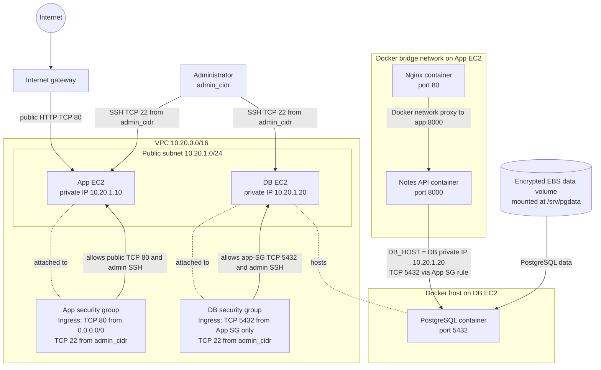

# AWS architecture

The diagram documents the configured network, dedicated database EBS volume,
and app stack. PostgreSQL and `db_backup` are implemented and integrated into
`ansible/playbooks/site.yml`. The application stack runs only after the app host
successfully checks the PostgreSQL private listener.

Terraform configures the VPC, public subnet, internet gateway and default
internet route. Both instances use fixed private addresses in that subnet and
are assigned public addresses. The app security group permits inbound TCP 80
from anywhere and TCP 22 only from `admin_cidr`. The database security group
permits TCP 5432 from the app security group and TCP 22 only from
`admin_cidr`; it has no public PostgreSQL ingress rule.

On the app host, the Compose project creates a Docker bridge network. Nginx
publishes host port 80 and proxies to the `app` service on port 8000. The app
receives `DB_HOST` from `/opt/stacks/app/.env`; its intended DB endpoint is
the database host's private IP. The DB environment file path is
`/opt/stacks/db/.env`.

Terraform provisions an encrypted EBS data volume, attaches it to the DB
instance, and exposes its ID to Ansible inventory. The `postgres` role
identifies the attached device, mounts it at `/srv/pgdata`, and deploys
PostgreSQL; `db_backup` runs after that role. The playbook then waits for
PostgreSQL from the app host before running `app_stack`.

Local tests and static validation pass. No real AWS deployment, EBS mount test,
reboot persistence test, or backup execution on AWS has been performed. No
restore demonstration has been completed, and end-to-end recovery remains
pending. The implemented configuration is not evidence that these AWS
behaviors have been verified.
